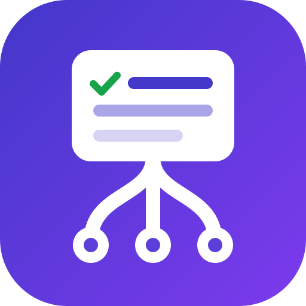

<p align="center">
  
</p>

<h1 align="center">project-memory</h1>

<p align="center">
  A plan, a task board, a decision log, learnings and a session handoff for every git repository —<br>
  kept by Claude Code itself, shared by all your worktrees, local by default.
</p>

<p align="center"><b>English</b> · <a href="README.ru.md">Русский</a></p>

---

## Why

Claude Code forgets between sessions. On anything longer than one sitting that costs you:

- every new session starts with "where did we stop?" and a re-read of the repository;
- the reasons behind earlier choices are gone, so settled questions get argued again;
- two worktrees of the same repo know nothing about each other and can pick up the same work;
- a plan written by another tool (superpowers, gstack, plan mode) drifts away from what is actually done.

project-memory keeps one small board per repository and puts a 40-line summary of it into the start of
every session. Claude keeps the board current on its own: it creates tasks, moves statuses, logs what it
did and what comes next, and records decisions with what was rejected.

## Install

Requires Node ≥ 20 and git. Works on macOS, Linux and Windows. No dependencies.

```
/plugin marketplace add ZizzX/claude-project-memory
/plugin install project-memory@project-memory
```

Restart Claude Code (a new process, not `/clear`) so the hooks load.

**Update:** when a newer version is already on this machine or has been released, the session summary says so:

```
[pm] update available: 0.3.0 → 0.3.1 — say "update the plugin", "later", "never" or "update it yourself"
```

Say **"update the plugin"** and Claude installs it and tells you to restart; **"later"** snoozes it for
7 days (a newer release than that one still speaks up), **"never"** stops the notice for good, and
**"update it yourself, do not ask"** lets Claude install new versions on its own from then on — it still
reports what landed. Your answer is stored in `git config --global`: `pm.updateNotify` (`ask` | `auto` |
`never`) and `pm.updateSnoozeUntil`. Nothing is installed without your yes.

By hand it is:

```
/plugin marketplace update project-memory
/plugin update project-memory@project-memory
```

Then restart Claude Code again.

The check costs two local file reads: the copy of the marketplace Claude Code already keeps. Once a day
it also reads the released `plugin.json` over HTTPS, in a background process that never delays a session —
turn that off with `git config --global pm.updateCheckNetwork false`; the local check keeps working.

## Quick start

1. Open a repository and start real work: "let's build the CSV import". For non-trivial, multi-step work
   Claude creates the board (`pm init`), fills `PLAN.md` and imports existing plans. You can also say
   "create a board".
2. Ask **"break it down"**. Claude creates tasks with order and dependencies, and links a detailed plan.
3. Ask **"what's next?"**. Claude claims the first ready task and writes down how it understands it.
4. Work as usual. When you stop, say **/close**: Claude closes or logs every task with the exact next step,
   records what the session taught, and picks the task the next session starts with.
   ("we're done" on its own only logs the next steps.)
5. `/clear` or come back tomorrow in any worktree. The session opens with the summary and carries on.

Open `board.html` (the link is in the summary) for a kanban view that refreshes every 10 seconds and keeps the cards you opened and the scroll position.

## Four ways it is used

| Way | What it is | Who uses it |
|---|---|---|
| **Hooks** | Run automatically: summary at session start, reminders, safety notes | nobody — they just run |
| **Phrases** | Plain language in the chat, like "what's next?" | you |
| **`/pm`** (also `/project-memory:pm`) | The skill: the protocol Claude follows for every situation | Claude; you, to read the rules |
| **`pm` CLI** | The commands that change the board | Claude; you, when you want to |

To see every command and phrase at once:

```
node ~/.claude/plugins/marketplaces/project-memory/scripts/pm.mjs help
```

### `pm` in an ordinary terminal

The CLI does not need Claude Code. Say **"add the pm alias"** in a session, or run once:

```
node ~/.claude/plugins/marketplaces/project-memory/scripts/pm.mjs alias
```

(Installed from a local folder? Take the path from the `CLI:` line of the session summary.)

It adds `pm` to every PowerShell profile and to Git Bash on Windows, to `~/.zshrc` or `~/.bash_profile` on macOS,
to `~/.zshrc` or `~/.bashrc` on Linux, and prints the files it touched. Running it again is safe, and a `pm` you
defined yourself is left alone. Open a new terminal: `pm board` prints the path to `board.html`, `pm help` lists the rest.
If PowerShell refuses to load the profile, allow it once with `Set-ExecutionPolicy -Scope CurrentUser RemoteSigned`.

## What to say

| You say | Claude does |
|---|---|
| "what's next?", "take the next one" | `pm ready`, claims the first task of this worktree's direction, writes `## Understanding` first |
| "break it down" | Creates tasks with `--order`, `--deps`, `--epic`; puts detail in a plan file and links it |
| "remember …" | Puts it in exactly one place: a decision, auto-memory, or the task's `## Understanding` |
| "waiting for …" | `status=waiting` with the reason; the task leaves Ready |
| "we're done", "continue in a new session" | Logs `did` / `next` on every active task of this worktree, updates focus |
| `/close`, "слил", "wrap up" | Closes the session: every task of this worktree closed or logged with a `next:`, the retro, the task the next session starts with — see [Closing a session](#closing-a-session) |
| "what did we learn", "что узнали нового" | The retro: records a lesson (`pm learn add`) or says there is none (`pm learn none`) — see [Learnings](#learnings) |
| "next session starts with T-007" | `pm next`: the summary leads with that task until it is claimed |
| "audit the board", "аудит доски" | `pm audit`: stale tasks, dead worktrees, unused learnings; `--fix` for the mechanical part — see [Audit](#audit) |
| `/done`, "done, only merge left" | Checks the conversation against the definition of done, then `pm done`: the task is `done`, or awaits its merge and closes by itself once it lands — see [Closing a session](#closing-a-session) |
| "the plan changes" | Edits `PLAN.md`, adds a Changelog line, records a decision |
| "undo that", "undo the board change" | Reverts that change of the board itself with git |
| "undo the code of T-007", "remove the changes of T-007" | Shows the `undo:` block of `pm show T-007` with its risks, waits for your yes, then reverts the task's commits in a new undo task on a `revert/T-007` branch |
| "go back to the state before T-007" | Offers `git switch -c before/T-007 <base>` first — nothing is lost; the destructive ways only if you ask for them |
| "add the pm alias" | `pm alias`: `pm` works in any terminal, not only in Claude Code |
| "enable board sync", "connect the board" | Shows where the board would be pushed and waits for your yes |
| "update the plugin", "later", "never", "I'll do it myself" | Answers the `[pm] update available` line: installs the new version, snoozes it for 7 days, silences it, or just shows you the commands |
| "update it yourself, do not ask" | `pm.updateNotify=auto` — from then on Claude installs new versions without asking and reports what landed |

"undo T-007" on its own is ambiguous, so Claude asks which one you mean: the board change, the code of the
task, or the state the repository was in before it. The plugin never runs a destructive git command on your
code by itself — it prints the exact command and waits.

After you open an MR/PR for a task, say so or run `pm set T-NNN pr=<url>`: `pm show` then reads its state,
merge SHA and author, and the undo block targets the merge commit instead of the individual commits.

Russian phrases work too: «что дальше», «бери следующую», «разбей», «запомни», «закончили», «готово, закрываем»,
«продолжим в новой сессии», «слил», «закрой сессию», «что узнали нового», «в следующей сессии берём T-007»,
«аудит доски», «план меняется», «ждём», «отмени правку доски», «откати код T-007»,
«вернись к состоянию до T-007», «включи синхронизацию доски», «подключи доску», «добавь алиас pm», «обнови плагин»,
«позже», «не напоминай», «обновляй сам».

Every turn that changed the board ends with one line in your language, such as
`board: T-003 → done · new T-007 "data migration" (after T-005) · D-004`.

## The session summary

```
[pm] my-app · epic APP-12 · focus: import pipeline, parser done · board: file:///…/pm/board.html
Your worktree (feature-csv):
  T-003 CSV import [in_progress] → next: handle empty rows (2026-09-12, feature-csv)
Elsewhere: T-008 Export to XLSX @ feature-export
Ready: T-004 validation ← next · T-006 export · +2 in other epics (pm ready --all)
Waiting: T-005 ← answer about date format
Awaiting merge: T-002 (#14)
Merged, still open: T-001 (#12) — ask the user, then pm reconcile --yes <the ids they confirm>
Epics: APP-12 4/6 · APP-15 2/2
Decisions: D-004 Store board outside branches · D-003 Own format
Learnings: L-007 CI translation keys fail while local passes
CLI: node "…/scripts/pm.mjs" <command>
Rules: …
```

| Line | Meaning |
|---|---|
| header | project, this worktree's epic, its focus line from `PLAN.md`, link to the board |
| Your worktree | open tasks claimed here, with the last logged next step |
| Elsewhere | tasks in progress in other worktrees — do not take them |
| Ready | `todo` tasks whose dependencies are all done, for this worktree's epic. The task chosen by `/close` comes first, marked `← next` (`← next (after PM-009)` while its dependencies are open) |
| Waiting | tasks blocked on something outside the board, and what |
| Closed after merge | `review` tasks closed at this session start because their merge was seen |
| Awaiting merge | `review` tasks: finished, only the merge is left |
| Merged, still open | tasks whose merge was seen but that were never marked done: Claude asks before closing them |
| PR conflict | the task's `pr` comes from another branch than the task's; `pm reconcile` prints the fix |
| Epics | open / total per direction |
| Decisions | the three most recent |
| Learnings | up to 5 active learnings of this worktree's tasks (else the most recently seen), id and title only |
| Promote | learnings ready to become a rule, e.g. `L-003 (seen 4 in 3 tasks)`; only when there are any |
| `[pm] audit: N findings` | once a week, when the audit found something: run `pm audit` |

The summary never exceeds 40 lines. Detail stays in the files and is read only when needed.

## Several directions in one repository: epics

The board is one per repository, so unrelated work in different worktrees shares it. Give each direction
an **epic** — a free key on its tasks, usually the Jira/Linear epic or ticket key, or a short slug:

```
pm task new --title "Parser" --epic APP-12 --links docs/plans/csv-import.md
```

- **A worktree's epic is what its claimed tasks carry**, never the branch or directory name. The summary,
  `pm ready` and the focus line are narrowed to it.
- **A task without an epic is repo-wide** and shows in every direction. `--epic ""` creates one on purpose.
- **A fresh worktree** that has claimed nothing gets a summary with one ready task per epic, tagged
  `(APP-12)`, and no foreign focus line. `pm ready` there lists every ready task with its tag. The worktree
  starts its own direction with `pm task new --epic <KEY>`.
- **Dependencies may cross epics.** A task is ready when its dependencies are done, wherever they live.
- **`PLAN.md` focus is one line per epic:** `- APP-12: parser done, validation next`.
- **Closing is automatic.** When no task of an epic is open any more, its cards leave the columns and
  move into `Archive` as a group of cards you can still expand (Log, branch, PR, closing date). An epic
  whose tasks were all dropped just disappears. There is nothing to archive by hand.
- **Done stays short.** On a board with epics the Done column keeps the latest 5 tasks closed in the last
  20 days; older done cards go to the `Done earlier` group of `Archive`.
- `pm epics` lists every direction with open/total and its focus line.

Boards without epics behave exactly as they did before epics existed.

**Mapping a tracker epic.** Use the tracker's epic key as the board epic. One board task is one branch or
merge request: split a big ticket into several tasks, fold several small tickets into one. Put ticket keys
in titles and tracker links in `--links`. The tracker stays the team's view; the board is Claude's working
memory for that work.

## When to use it — and when not

Put work on the board when **any** of these is true:

- it will outlive the current session (`/clear`, tomorrow, next week);
- it will continue in another worktree or on another machine;
- it waits on something outside the code: a review, an answer, another team.

Typical shapes:

| Work | On the board |
|---|---|
| A feature over several merge requests | one epic, 5–15 tasks, a linked plan |
| One ticket, one merge request | one task, epic = ticket key or none |
| A refactoring in several passes | an epic slug like `refactor-forms` |
| A one-session fix, a review, a question | nothing; answer the Stop reminder "nothing to track" |

If a small fix spills into a second session, file the task then. It is cheaper than filing ahead.

## Closing a session

Say `/close` (or «слил», "wrap up"). It leaves the board in a state the next session can start from without
this conversation. Four steps, one exchange each, every step ends with a CLI call:

1. **Tasks of this worktree.** For each open task claimed here Claude asks: done, awaiting merge, or paused?
   Done or awaiting merge runs the `/done` procedure below. Paused is logged with a concrete next step:
   `pm log T-003 --did "…" --next "<exact next step>"`. Without a concrete `next:` the task is not logged.
   If no task is claimed but code changed, Claude offers to file one, or accepts "nothing to track".
2. **Retro.** The `retro` skill looks for lessons of this session (see [Learnings](#learnings)). It ends with
   `pm learn add …` for each lesson, or `pm learn none <id>` for every task that taught nothing. Then
   `pm learn check <ids>` over the tasks from step 1 must print `ok` before `/close` goes on.
   `/close --no-retro` skips the skill and runs `pm learn none` itself, so the checkpoint still exists.
3. **Next task.** `pm ready`, then you say which task the next session starts with (default: the first ready
   one, or "none"). `pm next <id>` marks it. If this epic's `## Current focus` moved, `PLAN.md` is updated.
4. **Wrap.** Four lines: the board diff line; `next session: <id> <title>`; whether the worktree can be
   removed (clean and pushed) or what is not committed or pushed; and that `/clear` is safe.

`/close` never removes a worktree, never pushes code, and never runs a git command that changes the
repository. Removing the worktree is yours.

### Closing one task: `/done`

When the work is finished, say `/done` (or "done, only merge left"). Claude checks the conversation first:
the checklist is closed and the verification really ran. Then it runs `pm done`, which prints what happened:

```
$ pm done T-042 --did "compared the two parsers, picked csv-parse"
T-042 → done: no PR or commits, nothing to merge

$ pm done T-041 --did "CSV import, tests green"
T-041 → review: #15 not merged yet; closes by itself after the merge (git config pm.autoClose false turns that off)
```

A task expects a merge when it has a `pr` or linked commits. `--pr <url>` stores the PR first,
`--no-merge` closes it now. If anything is unfinished, Claude says what, files leftovers as tasks and
logs the exact next step instead.

A `review` task closes by itself once its own merge is seen: at a later session start, or at once with
`pm reconcile`. A merge is seen in two ways:

- a commit on the default branch whose subject names the task: `feat(T-041): …` or `[T-041] …`
  (the body does not count);
- the forge: `gh` / `glab` reports the task's PR merged into the default branch. This runs in the
  background (at most 5 lookups per run, never during a session start) or in the foreground with `pm reconcile`.
  Only origin's host is asked: a `pr` on another host is reported, not looked up. Without `gh` / `glab`
  the lookups pause for 24 hours, while the fetch of the default branch goes on.

A merge that happened before `pm done` (the first of two PRs) does not close the task. Tasks that were
merged but never marked done are only listed (`Merged, still open`); Claude asks before closing them:

```
$ pm reconcile
checked 3 of 3 tasks with a PR or branch
Closed: T-041 (#15)
Merged, still open: T-038 (#10) — close the confirmed ones: pm reconcile --yes <ids>, or pm set <id> status=done
Merge not checked: T-044 — gh is not installed — fix: install gh, run gh auth login, then pm reconcile
$ pm reconcile --yes T-038
Closed: T-038 (#10)
```

Every failure line says what happened, why, and the command that fixes it. `git config pm.autoClose false`
turns every automatic close into a question. When `origin/HEAD` is not set, `main` or `master` is
assumed and `pm reconcile` prints the fix once: `git remote set-head origin -a`.

**Upgrading.** Update every machine that shares the board: an older version shows
`bad status "review"` in its board-problems line and leaves `review` cards out of `BOARD.md` and
`board.html` (the task files stay). To roll back, first `pm set T-NNN status=in_progress` for each
`review` task. After the update, run `pm reconcile` once to find tasks merged earlier but never closed.

## Learnings

`decisions.md` records choices. A learning records a lesson: "this error means X, do Y". It has three
parts: the symptom as the next agent will see it, the fix, and how to apply it. Learnings belong to the
project: same board repository, same sync.

Each one is a file, `learnings/L-NNN.md`:

```markdown
---
id: L-003
title: CI translation keys fail while local passes
pattern: i18n.missing-key-in-ci
status: active            # active | promoted | retired
seen: 2
first: 2026-10-01
last: 2026-10-22
tasks: [PM-012, PM-019]
promoted_to: ""           # "<file>#<section>" once promoted
retired_why: ""
---
## Symptom
Unable to find … <key> in the DOM only in CI.

## Fix
The CI build runs with a stale locale bundle; rebuild locales before the e2e job.

## Apply
When a test fails on a translation key that exists locally: run `pnpm locales:build` first, do not
touch the component.
```

`pm learn` writes the frontmatter; the three sections are filled from flags and may be edited afterwards.

| Command | What it does |
|---|---|
| `pm learn add --title T --pattern area.symptom [--symptom S] [--fix F] [--apply A] [--tasks T-001]` | Record a lesson. `pattern` is `area.symptom`, lowercase |
| `pm learn list [--all]` | Active learnings; `--all` adds promoted and retired |
| `pm learn show L-003` | The file |
| `pm learn find <words…>` | Search title, pattern and body of active learnings |
| `pm learn promote L-003 --to <file#section>` | Mark it promoted (see below) |
| `pm learn retire L-003 --why "…"` | It proved wrong or obsolete |
| `pm learn none <task-id>` | The retro checkpoint when nothing was learned |
| `pm learn check <task-ids>` | `ok`, or the tasks that still owe a retro line (exit 1) |

**Dedupe by `pattern`.** A known pattern is counted, not duplicated:

- the same pattern as an active learning bumps `seen`, sets `last` and adds the tasks; no new file;
- the same task on the same day is a no-op, so `seen` counts recordings, not retries;
- a retired learning with that pattern is reactivated;
- a promoted one is left alone and the command prints where it was promoted;
- no exact match: the file is created, with a `similar:` hint if the `area.` prefix or a title word matches.

**Write nothing by default.** A learning is worth a file only when the next agent would otherwise hit the
same wall. The retro routes each candidate, first match wins: a skill that misfired is fixed, not
recorded; what is already in the repo, git, CLAUDE.md or a skill is not duplicated; a fact about you goes
to auto-memory; a verified procedure of two or more steps becomes a skill; a project lesson becomes a
learning; a code defect across the repo becomes a task. Never recorded: session state (MR numbers, test
counts, statuses), "X does not work" without a fix, one-off narratives, machine-specific paths or tokens.
Text is checked for secrets before it is written.

**In the session summary.** The `Learnings:` line lists up to 5 active learnings (those of this worktree's
tasks, else the most recent), from frontmatter only, so the summary does not grow with their number. The
`Promote:` line appears only when a learning has been seen 3 or more times in 2 or more tasks.

**Promotion.** A repeated learning can become a rule in the repo. Claude proposes the target (the repo's
CLAUDE.md or AGENTS.md, or the skill of that area) and a one-paragraph rule. Only after you say yes it
writes the rule there with a trailing `Source: L-003` line, then runs `pm learn promote L-003 --to
<file#section>`. The change in the repo is your commit. Claude never promotes on its own.

**Cap.** At most 100 active learnings per project; `pm learn add` refuses the 101st until you retire or
promote one (`pm learn list` shows them).

**Learnings and auto-memory.** Learnings are lessons of this project. Claude Code auto-memory stays
the place for facts about you and your preferences. Nothing here changes it.

## Audit

`pm audit` lists what went stale. It is deterministic, needs no LLM, and only reports: the exit code is 0
and nothing changes unless you add `--fix`. With nothing to report it prints `audit: clean`. Each finding
is one line: `<code> <id or file> — <what> — <fix or how>`.

| Code | Finding | `--fix` |
|---|---|---|
| `stuck` | `in_progress` whose last manual Log line (`did:`) is older than 14 days; `auto:` lines do not count; no Log line → `updated` | no — list |
| `waiting-long` | `waiting_since` (or `updated` when absent) older than 30 days | no — list |
| `review-no-pr` | `review` without `pr` | no — list |
| `dead-worktree` | `worktrees:` entry that `git worktree list` of this repo does not know | yes, only while sync is off — another machine's worktrees are invisible here, so with sync on it is listed only |
| `orphan` | `in_progress` with no `worktrees:` entry (its worktree was removed after `/close`) | no — list with "pm claim or pm set status=todo" |
| `learning-dup` | two active learnings with the same `pattern` | no — list |
| `next-stale` | `next:` older than 30 days or on a task that is no longer `todo`/`waiting` | yes — clear it |
| `state-old` | `.state/session-*.json` older than 7 days | yes — delete |
| `learning-unused` | active learning with `last` older than 90 days | no — list with `pm learn retire` hint |
| `learning-promote` | active learning past the promotion threshold | no — list |
| `learnings-cap` | more than 80 active learnings | no — list the count |
| `decision-dropped` | a decision whose `- tasks:` are all `dropped` | no — list |
| `retro-missing` | a `done`/`review` task whose last status date (last Log line, else `updated`) is on or after `retroSince` and within 30 days, with no `retro:` line | no — list |

`pm audit --fix` touches only what cannot be wrong: dead worktree entries (sync off), stale `next` marks and
session state files older than 7 days. It prints what it changed and commits `pm: audit --fix`. It never
changes a status and never deletes a task, a learning or a decision. Everything else is a question for you,
answered with the command the line names.

At session start, once every 7 days, the summary adds `[pm] audit: N findings — run: pm audit` when the
count is above zero. That count never fixes anything.

## Commands

| Command | What it does |
|---|---|
| `pm init` | Create the board for this repository |
| `pm task new --title T [--order N] [--deps T-001,T-002] [--milestone M] [--epic KEY] [--links a,b]` | Create a task. Without `--epic` it inherits this worktree's epic |
| `pm set T-003 key=value …` | Change fields: `status`, `order`, `depends_on`, `waiting_on`, `milestone`, `epic`, `links`, `title`, `pr` (the MR/PR URL `pm show` reads) |
| `pm claim T-003` | Attach this worktree to the task and set `in_progress` (a `review` task stays `review`) |
| `pm log T-003 --did "…" --next "…"` | Append a work log entry |
| `pm done T-003 [--did "…"] [--pr url \| --no-merge]` | Finished and verified: `done`, or `review` until its merge closes it. Prints the outcome and why |
| `pm reconcile [--yes [ids]] [--no-fetch]` | Find merged tasks now: closes `review` ones, lists the rest (`--yes T-001,T-004` closes those, a bare `--yes` all of them), PR conflicts, tasks awaiting merge 7+ days, tasks it could not check |
| `pm show T-003` | What the task file does not say: branch, MR/PR state, timeline, commits, decisions, dependents, and the `undo:` block — the exact `git revert` / `git switch -c before/…` commands and their risks. Read-only |
| `pm decision --title T --why W --rejected R [--tasks T-001]` | Record a decision |
| `pm ready [--epic KEY \| --all]` | Ready tasks of this worktree's epic, of one epic, or all. Without an epic of its own the worktree gets all, tagged |
| `pm epics` | Every epic: open/total and its focus line |
| `pm prefix [KEY] [--start N]` | Show or set the task id prefix, e.g. `PM` → `PM-051`, for branches like `feat/PM-051/slug`. `--start N`: new ids continue from N. Stored in the board (`config.json`), so synced machines share it. Existing tasks keep their ids; the number continues |
| `pm next [<id> \| --clear]` | The task the next session starts with (one per epic; only a `todo` task); `pm claim` clears it |
| `pm learn add --title T --pattern area.symptom [--symptom S] [--fix F] [--apply A] [--tasks T-001]` | Record a lesson; a known pattern is counted, not duplicated |
| `pm learn list [--all] \| show <id> \| find <words…>` | List active learnings, show one, or search them |
| `pm learn promote <id> --to <file#section> \| retire <id> --why "..."` | Mark a learning as promoted to a rule, or retire it |
| `pm learn none <task-id> \| check <task-ids>` | The retro checkpoint: nothing learned / which tasks still owe one |
| `pm audit [--fix]` | What went stale (stuck, waiting, orphans, unused learnings…); `--fix`: the mechanical part |
| `pm validate` | Check ids, statuses, `waiting` without a reason, unknown or dropped dependencies, cycles |
| `pm board` | Redraw `BOARD.md` and `board.html`, print the path |
| `pm summary` | Print the session summary for this worktree |
| `pm scan` | List plan files in `docs/superpowers/plans`, `docs/superpowers/specs`, `docs/designs`, `.dev-cycle/tasks` and gstack ceo-plans, with checkbox progress |
| `pm sync on [--remote url] [--yes]` · `pm sync off` · `pm sync` | Opt-in sync across machines |
| `pm update [later \| never \| auto \| ask]` | The update notice: current and available version, the two commands to install it, and how it behaves from now on |
| `pm alias` | Add the `pm` alias to your shell profiles (PowerShell, bash, zsh) |
| `pm help` | All of the above, plus the phrases. `--help` after any command shows the same |

Statuses: `todo`, `in_progress`, `waiting` (needs `waiting_on`), `review` (awaiting merge), `done`, `dropped`.
"Blocked by another task" is a dependency, not a status.

## Hooks

| Event | What happens |
|---|---|
| **SessionStart** (startup, resume, clear, compact) | With sync on: commit, pull, check the memory link. Close `review` tasks whose merge is already known (local refs and the merge cache, no network); start a background merge check when the cache is older than 30 minutes. Redraw the board, validate it, print the summary. Once every 7 days it also counts audit findings and prints `[pm] audit: N findings` when there are any; it never fixes anything |
| **PostToolUse** (Write, Edit, MultiEdit, ExitPlanMode) | A file inside the board changed → redraw the views. A plan file was written → ask Claude to reconcile the board with it |
| **Stop** | Commit the board. If code changed but neither this worktree's tasks nor `PLAN.md` / `decisions.md` were touched for 20 minutes → ask Claude to log progress (at most once per 20 minutes) |
| **PreCompact**, **SessionEnd** | Append an automatic note (changed files, last commit) to this worktree's in-progress tasks and commit |

Plan files that trigger the reconcile nudge: `docs/superpowers/plans/`, `docs/superpowers/specs/`,
`docs/designs/`, `.claude/plans/`, `~/.gstack/projects/*/ceo-plans/`, `.dev-cycle/tasks/`.

Hooks never break a session: any error is swallowed, and the hook exits cleanly.

## Where things live

```
~/.claude/projects/<repo-key>/pm/          ($CLAUDE_CONFIG_DIR/projects/… if set)
├── PLAN.md          goal, milestones, current focus (one line per epic), changelog
├── tasks/T-NNN.md   frontmatter + Goal, Understanding, Checklist, Log
├── decisions.md     append-only D-NNN entries: what, why, what was rejected
├── learnings/L-NNN.md   one lesson each: symptom, fix, how to apply
├── config.json      task id prefix, startNumber, retroSince
├── memory/          Claude Code auto-memory, only when sync is on
├── BOARD.md         generated view, never edit
└── board.html       generated kanban, refreshes itself
```

- **One board per repository.** The key comes from the git common directory, so every worktree of the
  repo shares it; branches do not.
- **It is a git repository** (branch `pm`). Every change is a commit, so any change can be reverted:
  `git -C <pm dir> log --oneline`, then `git -C <pm dir> revert <sha>`.
- **Layers of memory, each in one place:** auto-memory holds durable facts about the project;
  `decisions.md` holds why things are the way they are; `learnings/` holds lessons about this project; a task file holds what and how for that work;
  `PLAN.md` holds where things stand. A direction's detailed plan is its own file, linked with `--links`.

A task file:

```markdown
---
id: T-003
title: CSV import
status: in_progress
order: 30
depends_on: [T-001]
waiting_on: ""
worktrees: [feature-csv]
milestone: M1
links: [docs/plans/csv-import.md]
updated: 2026-09-12
epic: APP-12
---
## Goal
## Understanding
## Checklist
## Log
- 2026-09-12 · feature-csv · did: tokenizer and header mapping · next: handle empty rows
```

Two more frontmatter fields appear when needed. `next: <date>` marks the `todo` task the next session
starts with (set by `pm next`, removed by `pm claim` or any move away from `todo`). `waiting_since: <date>`
is set when a task enters `waiting` and removed when it leaves. `config.json` holds the id prefix,
`startNumber` (from `pm prefix --start`) and `retroSince`, the date of the first retro on this board:
the audit asks for `retro:` Log lines only on tasks closed on or after it.

## Sync across machines (opt-in)

Nothing leaves your machine until you enable sync for a project.

1. Say **"enable board sync"** (or run `pm sync on`). Claude shows the remote and branch and waits for yes.
2. The board is pushed to branch `pm` of the project's own remote. Claude Code's auto-memory for the
   project moves into the board and syncs with it.
3. Afterwards every board change is pushed in the background; each session start pulls first.
   If commits stay unpushed for over a day, the summary says so.
4. On another machine: install the plugin, open the project, say **"connect the board"**.

**Privacy.**

- If the project's repository is public, the board and memory become public. Use
  `pm sync on --remote <private-url>`.
- To sync the board but keep memory local: `git config pm.syncMemory false` **before** enabling sync.
- `pm sync off` stops syncing and keeps the local board. The remote branch stays until you delete it.

**Conflicts.** The summary shows `[pm] sync conflict in …`. Claude follows the protocol: runs `pm sync`,
merges the listed markdown files keeping both sides, and syncs again. Nothing is discarded.

## Working with other tools

- **Plan writers** (superpowers, gstack, plan mode, dev-cycle): write the detailed plan with them. When the
  file is saved, Claude adds coarse tasks to the board with a link to it and never copies its content.
  Items removed from the plan become `dropped`.
- **Other memory or resume tools** (checkpoints, context-save skills, memory MCP servers): consider turning
  them off once the board works for you, so "where did we stop?" has one answer.

## Troubleshooting

| Symptom | Fix |
|---|---|
| No summary at session start | The repo has no board yet. Start multi-step work or say "create a board" |
| `[pm] this repo has a shared board …` | Sync is on elsewhere. Say "connect the board" |
| Changes to the plugin do not show up | Fully restart Claude Code. Check `~/.claude/plugins/installed_plugins.json` for the version |
| Summary shows `focus: —` | This worktree has no epic yet, or `PLAN.md` has no line for it |
| Stop keeps asking to update the board | Log progress, claim a task, or answer "nothing to track" |
| `[pm] board problems: …` | Run `pm validate` and fix the listed tasks |
| A wrong board change | Say "undo that", or revert it with git in the board directory |
| Code of a task has to go | Say "undo the code of T-007": you get the exact commands and the risks before anything runs |

## Development

```
node --test              # run all tests
claude --plugin-dir .    # try the plugin from this checkout without installing
```

Releasing a change to an installed plugin:

1. Finish the change and run the tests.
2. **Bump `version` in `.claude-plugin/plugin.json` as the very last edit**, then commit and push.
   `plugin update` compares only the version. A background marketplace refresh can copy the working tree
   the moment the version changes, so a version bumped mid-work installs half-finished code.
3. Run the two update commands, then restart Claude Code.
4. Verify: the version in `~/.claude/plugins/installed_plugins.json`, and
   `diff -rq ~/.claude/plugins/cache/project-memory/project-memory/<version> .` shows only `.git`.

Design notes live in [`docs/superpowers/`](docs/superpowers/).

## License

MIT
